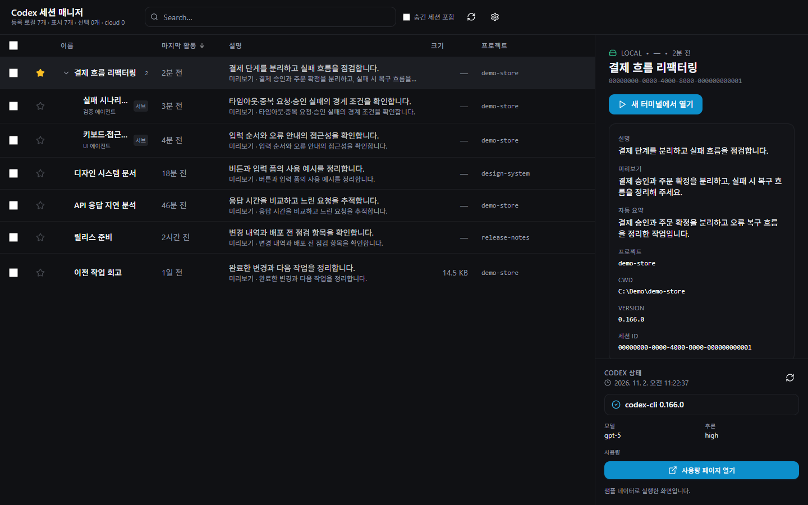

<p align="center">
  
</p>

<h1 align="center">Codex Session Manager</h1>

<p align="center">
  <strong>Codex의 대화를 찾고, 정리하고, 바로 이어가세요.</strong><br>
  부모·서브 세션을 한눈에 관리하는 Windows 데스크톱 앱입니다.
</p>

<p align="center">
  <a href="https://github.com/nowJDev/codex-session-manager/releases/latest"></a>
  
  <a href="LICENSE"></a>
</p>

<p align="center">
  <a href="https://github.com/nowJDev/codex-session-manager/releases/latest"><strong>최신 버전 다운로드</strong></a> ·
  <a href="#빠른-시작">빠른 시작</a> ·
  <a href="CHANGELOG.md">변경 내역</a> ·
  <a href="https://github.com/nowJDev/codex-session-manager/issues/new">문제 신고</a>
</p>

## 다운로드

[최신 릴리스](https://github.com/nowJDev/codex-session-manager/releases/latest)에서 사용 방식에 맞는 Windows x64 파일을 선택하세요. **Codex CLI는 별도로 설치해야 합니다.**

- **설치형 · 자동 업데이트 지원.** `*_x64-setup.exe`를 설치하고 실행하세요. 앱에서 업데이트를 확인할 수 있습니다.
- **포터블 · 설치 없이 실행.** `*_x64-portable.zip`의 압축을 풀고 `codex-session-manager.exe`를 실행하세요.

<details>
<summary>자동 업데이트용 파일 안내.</summary>

`latest.json`과 `.sig`는 설치형 앱의 업데이트 검증에 쓰는 보조 파일입니다. 직접 실행할 필요가 없습니다. 포터블은 최신 ZIP을 받아 실행 파일을 교체하세요. 자동 업데이트가 없는 v0.5.3 이하 설치본은 최신 설치 파일을 한 번 직접 받아 설치해야 합니다.

</details>

## 한눈에 보는 세션



<sub>공개용 샘플 데이터로 실행한 v0.5.12 프런트엔드 화면입니다. 실제 사용자 세션과 개인 경로는 사용하지 않았습니다.</sub>

## 작업을 이어가는 데 필요한 기능

- **찾기·정리.** 이름·설명·프로젝트·ID·대화 미리보기로 검색하고, 즐겨찾기와 정렬로 작업을 모읍니다.
- **서브 세션 트리.** 부모 아래에 서브 세션을 묶어 접고 펼칩니다. 하위 세션을 검색하면 부모도 함께 표시합니다.
- **터미널에서 재개.** 세션을 더블클릭해 `codex resume`으로 이어갑니다. Windows Terminal·PowerShell·cmd·Git Bash와 사용자 지정 터미널을 지원합니다.
- **확인하고 삭제.** 여러 세션을 선택하고 하위 세션까지의 영향 범위를 확인합니다. 삭제 후 Codex 등록 목록에서 사라졌는지 다시 검사합니다.
- **대화 요약.** Codex CLI로 대화를 읽어 이름과 설명을 생성합니다. 요약은 Codex CLI의 인증 상태를 사용합니다.
- **폴더 동기화.** 온전한 legacy JSONL과 메타데이터를 Google Drive 같은 로컬 동기화 폴더에 보관하고 다른 PC에서 가져옵니다.

## 빠른 시작

1. **Codex CLI를 준비하세요.** [OpenAI Codex CLI](https://github.com/openai/codex)를 설치하고 `codex --version`이 실행되는지 확인하세요. Manager는 `PATH`의 Codex를 찾습니다.
2. **Manager를 실행하세요.** 설치형 또는 포터블을 실행하면 등록 세션을 불러옵니다. 설정에서 사용할 터미널을 선택할 수 있습니다.
3. **이어갈 작업을 고르세요.** 검색하거나 부모 왼쪽의 화살표로 서브 세션을 펼치고, 원하는 세션을 더블클릭하세요. 이름·설명·즐겨찾기로 다음에 찾기 쉽게 정리할 수 있습니다.

## 사용 전에 알아둘 점

- **검증 환경은 Windows x64와 Codex CLI 0.166.0입니다.** 세션 목록·삭제·대화 조회를 위한 app-server API가 필요합니다. 호환되지 않는 CLI에서는 조회 오류를 표시합니다.
- **등록 수와 표시 수는 다를 수 있습니다.** 제외 경로와 내부 기록은 표시 필터로 구분합니다. `숨긴 세션 포함`으로 확인할 수 있으며, 전체 선택은 현재 표시된 등록 세션을 대상으로 합니다.
- **부모를 삭제하면 하위 세션도 영향을 받습니다.** 확인창에서 전체 영향 범위를 확인하세요. 결과가 미확인이거나 실패한 항목은 재확인·재시도할 수 있습니다.
- **paginated 세션의 클라우드 파일 백업은 지원하지 않습니다.** ID와 형식을 확인한 온전한 legacy JSONL만 동기화합니다. 불완전한 파일로 기존 백업을 덮어쓰지 않습니다.

<details>
<summary>조회·삭제·요약의 동작을 더 알아보기.</summary>

- JSONL 파일이 없는 DB 등록 세션도 Codex API가 반환하는 목록에서 조회합니다. 부모가 없는 서브 세션은 최상위에 표시하고, 파일 크기를 확인할 수 없으면 `—`로 표시합니다.
- 미보관·보관 세션을 함께 조회하며, 메뉴에서 보관·보관 해제를 실행할 수 있습니다.
- 조회에 실패하면 이전 목록과 오류 안내를 유지합니다. API 실패를 파일 강제 삭제로 우회하거나 Codex의 SQLite·세션 인덱스를 직접 수정하지 않습니다.
- 삭제는 ID로 요청하고 미보관·보관 목록에서 부재를 확인합니다. 앱 메타데이터 정리 경고는 삭제 결과와 구분하며, 확인 이후 영향 범위가 늘어나면 다시 확인합니다. 다른 프로세스와의 원자적 스냅샷은 보장하지 않습니다.
- 동기화 폴더 아래 `Codex Sessions`를 사용하며 부모 관계도 보존합니다. 복원은 기존 로컬 파일을 덮어쓰지 않고 Codex 등록을 확인합니다. 등록 미확인 시 복사 파일은 보존하고 오류를 알립니다.
- 수동 요약은 ID로 대화 내용을 읽습니다. 새로 발견한 과거 paginated 세션을 자동 일괄 요약하지 않으며 기존 legacy 자동 요약만 유지합니다.
- 기본 재개 명령과 사용자 지정 `{codex_invoke}`는 목록 조회와 같은 CLI 경로·`CODEX_HOME`을 사용합니다. 사용자 지정 명령은 Bash·Cmd·PowerShell 문법을 구분합니다.

</details>

## 설정과 개발

일반 설정은 앱의 설정 화면에서 변경할 수 있습니다. 자세한 설정과 개발 명령은 아래에서 펼쳐 보세요.

<details>
<summary>설정 파일·환경 변수·로그.</summary>

앱 전용 이름·설명·즐겨찾기·설정은 `~/.codex-sessions/config.json`에 저장됩니다. Codex의 기본 저장소는 `~/.codex`입니다. 추가 세션 경로, 제외 경로, 선호 터미널과 사용자 지정 재개 명령은 설정 화면에서 지정할 수 있습니다.

| 환경 변수 | 용도 |
| --- | --- |
| `CODEX_HOME` | Codex 홈을 직접 지정합니다. |
| `CODEX_SESSION_HOME` | 테스트·격리 실행용 홈입니다. `CODEX_HOME`이 없으면 이 경로 아래 `.codex`를 사용합니다. 앱 설정도 이 홈 아래에 저장합니다. |
| `CODEX_CLI` | `codex` 실행 파일 경로를 직접 지정합니다. |
| `GIT_BASH` | Windows의 `git-bash.exe` 경로를 지정합니다. |
| `WINDOWS_TERMINAL` | Windows의 `wt.exe` 경로를 지정합니다. |

재개 옵션에는 `--dangerously-bypass-approvals-and-sandbox`, `--debug`, `--verbose`와 자유 입력을 지정할 수 있습니다.

디버그 로그는 Windows의 `%USERPROFILE%\.codex-sessions\debug.log`, macOS/Linux의 `~/.codex-sessions/debug.log`에 저장됩니다. 설정에서 마지막 로그를 복사해 [문제를 신고](https://github.com/nowJDev/codex-session-manager/issues/new)할 수 있습니다. 공개할 로그에 대화·개인 경로가 포함돼 있는지 먼저 확인하세요.

</details>

<details>
<summary>소스 실행·빌드·테스트.</summary>

Node.js 24+, pnpm 11.8.0, Rust와 [Tauri 2 플랫폼 준비 사항](https://v2.tauri.app/start/prerequisites/)이 필요합니다. 데스크톱 앱은 Tauri·Rust·React로 구성됩니다.

```bash
git clone https://github.com/nowJDev/codex-session-manager.git
cd codex-session-manager
pnpm install --frozen-lockfile
pnpm tauri dev
```

Windows 설치 파일을 빌드하려면 다음 명령을 사용하세요. 산출물은 `src-tauri/target/release/bundle/`에 생성됩니다.

```bash
pnpm tauri build --bundles nsis
```

문제에 맞는 검사를 실행할 수 있습니다.

```bash
pnpm build
node --test tests/*.test.mjs
node scripts/check-delete-workflow.mjs

cd src-tauri
cargo test -- --test-threads=1
cargo build --bin session-cli
cd ..
```

`session-cli`는 GUI 없이 백엔드를 확인하는 하네스입니다. `paths`, `list`, `check-env`, `resume-plan <session-id> [cwd]` 명령을 제공합니다. 실제 API 검사는 프로젝트 루트에서 실행하며 모델 요청 없이 임시 세션만 사용합니다.

```bash
python scripts/check-codex-api.py --manager src-tauri/target/debug/session-cli.exe
```

Rust 코드는 [`domain`](src-tauri/src/domain)·[`application`](src-tauri/src/application)·[`adapters`](src-tauri/src/adapters) 경계를 사용합니다. React의 화면 흐름은 [`src/application`](src/application) 훅에서 조율합니다.

</details>

## 문서와 지원

[변경 내역](CHANGELOG.md) · [현재 기능과 검증 범위](docs/current-state.md) · [릴리스 검증 기록](docs/release-qa.md) · [문제 신고](https://github.com/nowJDev/codex-session-manager/issues/new)

## 라이선스와 출처

[MIT 라이선스](LICENSE)로 배포합니다. [glowElephant/claude-session-manager](https://github.com/glowElephant/claude-session-manager)를 fork해 OpenAI Codex CLI용으로 이식한 프로젝트입니다.
